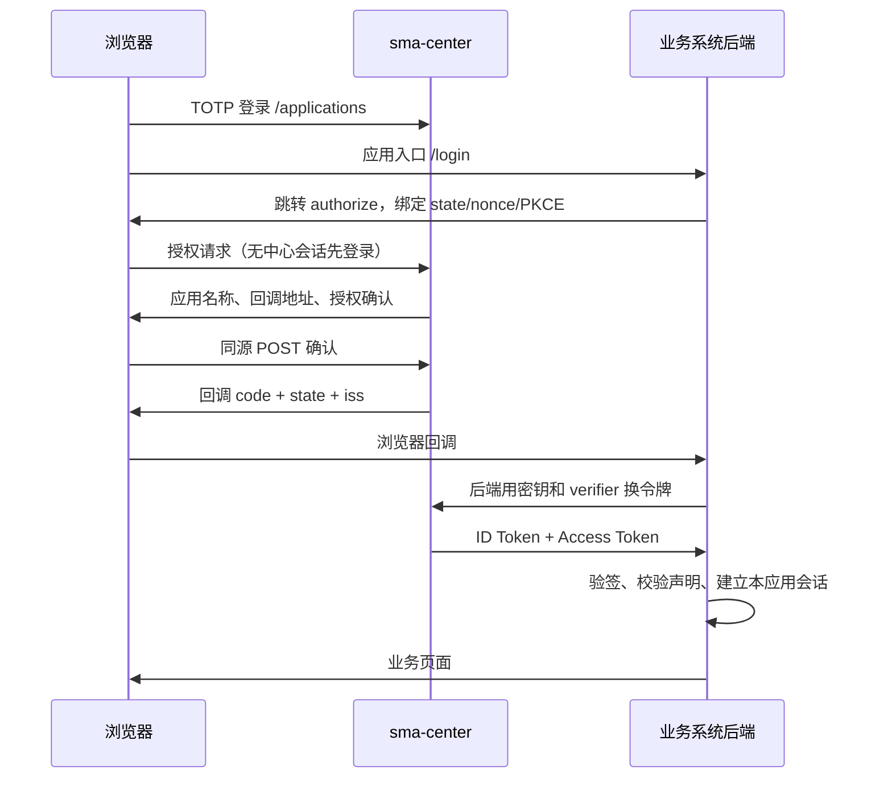

# sma-center 统一入口与 SSO 对接手册

本文对应本分支实现，面向中心管理员与业务系统开发者。中心已于 2026-11-04 部署并启用 HTTP IP issuer，见 [部署记录](deployment-status.md)。业务系统仍需分别注册和联调，不能以中心上线代替其验收。

## 1. 方案与边界

sma-center 是统一导航入口和身份提供方（OP），业务系统是 OIDC 客户端（RP）。用户在中心完成 TOTP 登录，在 `/applications` 选择应用；应用发起授权码流程，中心显示授权确认页，用户确认后应用获得可验证的身份，创建自己的服务端会话。已有中心会话时不重复输入 TOTP，但仍需确认每次授权。



| 项目 | 当前实现 |
| --- | --- |
| 用户 | 保留单用户 TOTP，唯一主体 `sub=selfhost:admin`；身份主键是 `(iss, sub)` |
| 客户端 | 管理员预注册的可信服务端 Web/BFF，支持不同域名与独立 Cookie |
| 协议 | OIDC 授权码模式，强制 S256 PKCE；RS256 ID Token、JWKS、Discovery、UserInfo |
| 应用授权 | 仅已注册应用能申请此单一主体；每次授权要求确认 |
| 令牌管理 | 私密客户端 Basic/Post 认证；内省、撤销；中心注销立即使在线验证失效 |
| 入口 | 侧栏“业务应用”及 `/applications`；入口指向业务系统的登录启动地址 |
| 原有功能 | 资源、SMA 指标、版本中心、TOTP、存储主体和加密凭据保留，无数据库迁移 |
| 未实现 | 多用户/组织/租户、中心 RBAC、用户同步 SCIM、SAML、LDAP、刷新令牌、机器 client_credentials、动态注册、SPA 直连、第三方身份源、OpenID 官方认证 |
| 部署 | 单实例；授权事务和令牌存于内存，重启后需重新登录业务应用；不支持多副本负载均衡 |

统一入口并不代理所有业务 HTTP 流量。各应用必须在后端保护所有页面/API；用户直接输入业务 URL，也必须经过本应用会话检查并转向中心认证。仅添加导航链接不能构成 SSO，也不能防止绕过认证。需要统一域名反向代理、网络隔离或旧系统身份头适配时，须单独配置网关与应用访问限制；本实现不向任意旧应用注入可信身份头。

本方案基于 [OIDC Core](https://openid.net/specs/openid-connect-core-1_0.html)、[PKCE RFC 7636](https://www.rfc-editor.org/rfc/rfc7636.html)与 [OAuth 安全 BCP RFC 9700](https://www.rfc-editor.org/rfc/rfc9700.html)实现受限配置，不声称支持所有 OIDC 可选功能或已获得 OpenID 认证。

## 2. 中心启用配置

默认不启用 SSO。未配置 issuer 时，现有 TOTP 登录、API 与 Token 不变，“业务应用”显示未启用提示。启用后服务启动时检查客户端文件和签名密钥，错误则拒绝启动，避免带错误认证配置运行。

| 环境变量 | 默认/要求 |
| --- | --- |
| `SMA_CENTER_SSO_ISSUER` | 未设置则关闭；固定 HTTP/HTTPS origin；本次使用 `http://192.168.33.124:8080`，不带路径、查询和末尾 `/`，支持内网 IP |
| `SMA_CENTER_SSO_CLIENTS_FILE` | 默认 `${SMA_CENTER_DATA_DIR}/oidc-clients.json`，须是 JSON 数组，可用 `[]` 启用空目录 |
| `SMA_CENTER_SECURE_COOKIES` | 本次 HTTP IP 部署设为 `false`；仅 HTTPS issuer 设为 `true` |
| `SMA_CENTER_DATA_DIR` | 保持原有数据卷；不要为了启用 SSO 新建空卷替代生产卷 |

issuer 是唯一可信外部来源，同时用于写请求的 Origin 校验、Discovery 和令牌 `iss`，不会信任客户端的 `X-Forwarded-*`。浏览器必须通过该 issuer 访问，含正确协议/域名/端口；不能同时混用 IP、HTTP 和 HTTPS 登录写入。没有 SSO issuer 时，原有 HTTP Host 来源校验仍保留。

Docker 环境覆盖文件示例（先用工具创建客户端文件，再设置 SSO 并在维护窗口重建；以下 IP/端口按本次内网地址填写，现场变更时须同步修改）：

```yaml
services:
  sma-center:
    environment:
      SMA_CENTER_SSO_ISSUER: http://192.168.33.124:8080
      SMA_CENTER_SECURE_COOKIES: "false"
      SMA_CENTER_SSO_CLIENTS_FILE: /data/oidc-clients.json
```

把配置保存在部署目录的现场覆盖文件，例如 `compose.sso.yaml`；沿用已有卷与恢复覆盖文件。所有后续 `up/build/exec` 等命令都应使用同一组 `-f` 参数。此处不提供会覆盖现有网络/卷配置的一键生产命令。不要把真实客户端文件、密钥和现场配置提交 Git。

本次采用 HTTP IP 直连，无需域名、证书或 HTTPS 代理。中心 issuer 为 `http://192.168.33.124:8080`，Software Vault 的应用 origin 为 `http://192.168.33.81:8096`，回调为 `http://192.168.33.81:8096/auth/callback`。这是本次接入配置约定，是否已在服务器启用仍须查看部署记录与实测；代码交付不代表已上线。

中心登录 Cookie 使用 HttpOnly、SameSite=Lax，HTTP 时不设置 Secure；各应用使用独立 host-only Cookie。固定 issuer 校验、授权确认的一次性事务、PKCE、精确回调及令牌验签均保留。确认页的 CSP 只允许自身和已注册回调来源。HTTP 不加密传输，按本次可信内网使用；后续如切换 HTTPS，再同步改双方 origin、回调与 Secure Cookie。

## 3. 注册、轮换和下线业务应用

在中心的运行用户权限下执行。工具读取相同 DATA_DIR/CLIENTS_FILE，以原子替换方式更新客户端列表并生成 32 字节随机密钥；列表只存 SHA-256 摘要，原始密钥单独写入权限 0600 的一次性交付文件，终端仅输出文件路径。**串行执行管理命令，禁止多个进程并发修改列表。**

```sh
# 本地示例（生产容器使用相同命令，并保持原 Compose 覆盖参数）
node deploy/sso-client.mjs add software-vault "Software Vault" \
  http://192.168.33.81:8096/login \
  http://192.168.33.81:8096/auth/callback

node deploy/sso-client.mjs rotate software-vault
node deploy/sso-client.mjs remove software-vault
```

`add ID NAME ENTRY_URL CALLBACK_URL [...CALLBACK_URL]` 支持最多 100 个客户端，每个最多 20 个回调。ID 为 1～80 位字母数字下划线连字符。入口必须与至少一个回调同源；入口应启动 OIDC 登录，不要配置成不受保护的业务主页。回调逐字匹配，禁止通配符；协议、端口、大小写、尾部 `/`、查询参数均需一致。支持 HTTP IP 和 HTTPS URL，禁止其他协议、URL 用户名、密码和 fragment。

交付密钥文件中的原文给业务系统后端，妥善配置后删除交付文件（包括轮换前遗留交付文件）；后端通过密钥管理或权限受限文件读取。不要放前端源码、URL、Git、构建镜像、截图或工单。默认数据目录已被 Git 忽略；自定义目录的忽略和权限由管理员维护。

文件结构（摘要为占位值，不可直接用于认证）：

```json
[
  {
    "client_id": "software-vault",
    "name": "Software Vault",
    "entry_url": "http://192.168.33.81:8096/login",
    "redirect_uris": ["http://192.168.33.81:8096/auth/callback"],
    "secret_sha256": "<工具生成的64位十六进制摘要>"
  }
]
```

列表在每次协议/目录请求时重读，删除客户端或轮换密钥后，不需要重启中心，旧访问令牌在线验证立即失效；未交换的旧密钥授权码也不能兑换。轮换只接受一个新密钥，没有双密钥宽限期，应协调双方短暂重登录。删除再重新注册视为新授权配置，重新发起登录。不要只删除应用导航来替代移除客户端。

## 4. 业务系统配置与开发要求

每个业务系统使用独立 client_id/secret、回调地址和会话密钥。应优先使用所属框架维护的 OIDC 服务端客户端库，按本节开启 PKCE 和校验，不能只解码 JWT 就认为登录成功。若框架默认强制 HTTPS，应显式允许本次固定 HTTP issuer/应用 origin，不把 HTTPS 作为 IP 接入的前置条件。

```text
issuer: http://192.168.33.124:8080
client_id: software-vault
client_secret: 从受限文件或密钥管理服务读取
redirect_uri: http://192.168.33.81:8096/auth/callback
response_type: code
scope: openid profile
code_challenge_method: S256
token_endpoint_auth_method: client_secret_basic
```

1. 后端为每次登录生成独立的加密随机 `state`、`nonce` 和 `code_verifier`，保存在绑定浏览器 Cookie 的短期服务端事务中，建议 5 分钟；不要只存在可被修改的浏览器变量。verifier 使用 43～128 位 `[A-Za-z0-9._~-]`，推荐 32 个随机字节的 base64url（43 位）。challenge 为 verifier 的 SHA-256 无填充 base64url。
2. 浏览器顶层跳转到 authorize。state 必填、最多 512 字符；nonce 本配置要求 16～256 位 base64url。不要用 iframe 或 AJAX 跨域调用授权页面。
3. 回调先校验事务 Cookie、唯一 state、响应 `iss` 等于固定 issuer，拒绝重复参数和未知/过期事务，再消费事务；`error` 存在时终止。不要信任回调附带的用户名或任意 `returnUrl`。
4. 服务端用原始回调 URL、verifier 和客户端密钥调用 token；密钥只由业务后端发送，不交给浏览器。ID Token 必须校验 RS256 签名、可信 JWKS 的 kid、固定 iss、aud 等于本 client_id、exp、iat 和原始 nonce；实现通用库时还应遵守其多 audience/azp 校验。未知 kid 最多刷新一次公钥，失败拒绝登录。
5. 使用已验证的 `(iss, sub)` 关联本地用户。name 只是展示名称，不用于账号匹配；当前无 email、roles、groups、tenant 声明。禁止按同名自动合并已有管理员账号，禁止看到 `selfhost:admin` 字符串就跳过验签或直接授予超级管理员。
6. 创建本应用随机服务端会话，登录完成轮换会话 ID。浏览器只持有本应用 HttpOnly、SameSite=Lax Cookie；HTTP 时不设 Secure，HTTPS 时设置 Secure，使用 host-only Cookie，不设置共享父域 Domain。令牌、verifier 和密钥保存在后端，回调后立即跳转到干净 URL，禁止记录回调查询串。
7. **全部业务页面/API** 都校验本应用会话。权限由应用本身维护：为身份分配明确的本地角色/资源权限，未分配就拒绝访问。认证成功不代表允许所有业务操作。
8. 若要求中心退出后业务访问立即拒绝，每次受保护请求都在后端内省 access token，要求 active=true、sub 与会话一致、client_id 与本应用一致；中心不可用时拒绝受保护访问。可做至多 30 秒短缓存，但这也定义了撤销最大延迟。不能靠离线 ID Token 实现立即退出。
9. 本配置无 refresh token。令牌到期后重新发起授权，中心会话仍有效时无需再次 TOTP，但仍需授权确认。业务会话不得超出本次令牌过期时间。

纯 SPA 应加 BFF，由 BFF 执行交换、验签和令牌管理；本配置不开放 CORS，不支持把 client_secret 发到浏览器。机器任务/Agent 继续使用独立机器凭据，不使用人的 ID Token。

## 5. 协议接口与请求示例

设 `ISSUER=http://192.168.33.124:8080`。

| 接口 | 方法与用途 | 认证 |
| --- | --- | --- |
| `/.well-known/openid-configuration` | GET 协议发现 | 公开 |
| `/oidc/jwks` | GET RSA 公钥集 | 公开，仅公钥 |
| `/oidc/authorize` | GET 发起授权 | 中心浏览器会话，无会话跳转登录 |
| `/oidc/consent` | POST 内部授权确认 | 中心会话、同源、一次性事务；RP 不直接调用 |
| `/oidc/token` | POST 授权码兑换 | 客户端 Basic 或表单密钥，强制 PKCE |
| `/oidc/userinfo` | GET 身份信息 | `Authorization: Bearer <access_token>` |
| `/oidc/introspect` | POST 令牌有效性 | 客户端认证，只查看本客户端令牌 |
| `/oidc/revoke` | POST 撤销访问令牌 | 客户端认证，只撤销本客户端令牌 |
| `/applications` | GET 已注册应用目录 | 中心浏览器会话 |

授权请求示意（所有值用 URLSearchParams 编码）：

```text
GET /oidc/authorize?client_id=software-vault&redirect_uri=https%3A%2F%2Forders.example.com%2Fauth%2Fcallback&response_type=code&scope=openid%20profile&state=<随机state>&nonce=<随机nonce>&code_challenge=<S256结果>&code_challenge_method=S256
```

成功回调：`http://192.168.33.81:8096/auth/callback?code=<一次性码>&state=<原state>&iss=<编码后的issuer>`。回调地址原来带查询参数时会保留原参数，业务方不要预置 `code/state/iss/error` 等响应参数。

Token 请求：`Content-Type: application/x-www-form-urlencoded`，推荐 `Authorization: Basic base64(formEncode(client_id)+":"+formEncode(client_secret))`，body：

```text
grant_type=authorization_code&code=<code>&redirect_uri=<原始回调URL>&code_verifier=<原verifier>
```

也支持 body 携带 `client_id` 和 `client_secret`，不能同时使用两种客户端认证方式。不允许重复参数。JSON 请求体不接受；body 上限 8 KiB。后端端点不需要浏览器 Origin，依靠独立客户端密钥认证；授权确认与中心业务写接口仍严格同源校验。

成功响应：

```json
{
  "access_token": "<随机不透明访问令牌>",
  "token_type": "Bearer",
  "expires_in": 300,
  "scope": "openid profile",
  "id_token": "<RS256签名JWT>"
}
```

授权码最长 60 秒且只能使用一次；访问令牌和 ID Token 最长 300 秒，不能超过签发时中心会话的剩余有效期。失败的绑定客户端 PKCE 兑换会消耗该授权码，必须重新开始。码与访问令牌只在内存中以摘要作为索引保存；ID Token 带 `iss/sub/aud/iat/exp/nonce`，profile scope 额外带 name。不能把 ID Token 当成中心 API 或 SMA Agent 的访问令牌。

UserInfo：`{"sub":"selfhost:admin","name":"工作台所有者"}`；没有 profile scope 时只有 sub。

内省/撤销使用与 token 相同的表单、客户端认证，body `token=<access_token>`。有效内省返回 `active/client_id/sub/scope/token_type/exp/iss/aud`；未知、过期、已撤销或其他客户端的令牌只返回 `{"active":false}`。撤销返回 200 `{}`，未知令牌也返回成功。UserInfo 无效令牌返回 401 和 Bearer challenge。

错误以 OAuth `error` 字段返回：`invalid_request`、`invalid_client`、`invalid_grant`、`invalid_scope`、`unsupported_response_type`、`unsupported_grant_type`、`access_denied` 等。客户端不存在或回调不匹配时直接 400，绝不跳转到该 URL。合法回调的授权错误带原 state 与 iss。`prompt=none` 在未登录时返回 `login_required`，已登录时返回 `consent_required`；不做无交互授权。只支持省略 prompt 或 `consent/none`、query response mode；`prompt=login`、max_age、claims、request、request_uri、offline_access 等不支持时明确拒绝，客户端库需关闭这些选项。

## 6. 可运行的业务端参考

仓库提供 [Node BFF 示例](../examples/sso/client.mjs)，不依赖额外包，包含服务端 state/nonce/PKCE、回调校验、JWKS 验签、本应用会话、逐请求内省和本地退出。它是可配置 HTTP IP/回环地址的演示程序，不是生产业务系统或通用 OIDC SDK。

中心本地注册：

```sh
node deploy/sso-client.mjs add demo "SSO 演示系统" \
  http://localhost:4000/login http://localhost:4000/callback
SMA_CENTER_SSO_ISSUER=http://localhost:3000 npm run dev
```

保留已有 TOTP 绑定，从工具输出的受限交付文件路径读取 secret。另一个终端启动示例（路径自行替换，内容不要粘到命令行）：

```sh
OIDC_ISSUER=http://localhost:3000 \
OIDC_CLIENT_ID=demo \
OIDC_CLIENT_SECRET_FILE=/absolute/path/to/delivery.secret \
node examples/sso/client.mjs
```

访问 `http://localhost:3000/applications`，选择演示系统，按提示登录和确认；也可直接访问 `http://localhost:4000`，应自动进入同一认证流程。本地两端统一用 localhost，不混用 127.0.0.1。示例默认监听 localhost，可通过 `OIDC_APP_ORIGIN=http://<本机IP>:4000` 绑定本机对应 IP（同时在中心注册相同 origin 的回调）。HTTP 下无 Secure Cookie。真实业务使用成熟 OIDC 客户端、持久会话存储和本地权限。

## 7. 退出、撤销与故障

- 本应用退出：必须同源 POST、销毁本应用会话并调用 revoke；不自动退出其他应用或中心。中心会话尚在时再次登录仍可直接进入授权确认。
- 全局撤销：在中心 `/security` 点击退出，会轮换现有 TOTP 会话代次；旧中心会话、授权事务、授权码及 access token 在线验证失效。执行离线 TOTP 重置也会使旧授权失效，但不要把重置当普通退出。
- 本实现不提供标准 RP-Initiated Logout、Front/Back-Channel Logout 或自动删除各站 Cookie。不能让跨域应用直接 POST 中心 `/logout`，该请求会被 Origin 保护拒绝。业务系统通过内省实现实际访问撤销，浏览器 Cookie 留存不代表还有权限。
- 离线验证的 ID Token 在 exp 之前仍能验签，已签发 JWT 无法远程抹除。要求即时撤销必须内省并约束本地会话；高风险操作可额外要求再次登录/本地确认，本配置不支持 max_age 强制新 TOTP。
- 中心不可达、超时、无效签名或发现配置不匹配：拒绝新登录和需要在线验证的业务访问；已有 Agent 后端 Token 不因此改变。
- 401 invalid_client：核对 ID、原始 secret、所用认证方法和轮换状态；不要把 secret 的 SHA-256 摘要当成原文发送。
- 400 invalid_grant：检查 60 秒时效、是否二次兑换、verifier、原始回调、中心重启或退出；不要反复重用同一 code。
- 写操作 403：核对浏览器 Origin 与固定 issuer 一致、HTTPS Secure Cookie 配置、表单 Referrer-Policy；不要关闭来源校验。
- 应用回调后 401：检查 state Cookie、nonce、服务器时钟/NTP、JWKS 与 aud；不要改成只解析 JWT。

## 8. 运维、备份、审计与验收

数据目录新增 `oidc-clients.json`（摘要和配置）与 `oidc-signing-key.pem`（RSA 私钥）；交付 `.secret` 文件仅临时存在。沿用原 secrets.json、totp-auth.json、数据库，**不要重新生成既有凭据加密密钥**。完整卷备份包含上述文件，页面 JSON 导出不包含 SSO。自定义 CLIENTS_FILE 在卷外时必须单独受保护备份，恢复时使用同一 issuer、注册表与密钥。

签名私钥首次启用时生成并以 0600 保存，重启保持 kid；没有在线双钥轮换接口。需要轮换时安排维护窗口、停止中心、备份旧密钥、替换密钥并重启，再清理/重建业务会话、刷新各客户端 JWKS。未知 kid 刷新后仍失败须拒绝访问，不能回退到任意算法/密钥。不要直接在运行中删除签名文件期待热更新。

中心日志仅记录事件名和 client_id，不记录授权码、TOTP、密钥、Token、Cookie 或完整 URL。反向代理和各业务应用也要禁止记录 authorize/token/callback 的查询串和请求体。示例 Nginx 还需按现场日志策略关闭敏感路由访问日志或只记录 `$uri`，不要使用默认 `$request` 记录回调完整 URL。生产入口配置连接/请求速率限制，客户端凭据接口不对外提供匿名开放调用。内存表上限每类 10000，超额拒绝，不做无限累积。

上线验收至少覆盖：

1. 备份与原 TOTP、导航、资源、Agent Token 解密回归；开启 SSO 不改变既有内部主体。
2. 使用两个独立域名业务系统，测试从中心入口和直接业务 URL 登录、无中心会话需 TOTP、有会话仍需授权确认；取消不会进入业务。
3. 伪造回调/重复参数、错误 state/nonce、错误 issuer/aud、伪造 JWT、plain PKCE、错误 verifier、授权码重放、跨客户端兑换、过期与已删除客户端全部拒绝。
4. 中心退出后各业务系统下次在线内省拒绝；本应用退出不会错误清除其他应用登录；中心不可达按策略拒绝，验证缓存最大延迟。
5. 测试两个 HTTP IP 间的跨站 Cookie、固定来源、端口、NTP、日志脱敏和回调后 URL 清理；不要求域名、证书或 HTTPS。
6. 验证重启中心只需业务重新授权，原 TOTP、Agent 凭据、配置和 JWKS kid 保持；客户端轮换及下线立即阻止旧令牌。

开发检查：`npm test`、`npm run lint`、`npm run build`。构建后，可选执行 `SMA_CENTER_BROWSER_TEST=1 node --test tests/request-origin.test.mjs tests/oidc-browser.test.mjs`，需本机 Chrome 和本地监听权限。浏览器测试只使用临时目录和随机回环端口，不访问生产数据。

当前验证结果应随提交说明记录：协议单元测试与完整项目检查通过才可进入评审；本地 HTTP 浏览器通过不等于目标内网 IP 和第三方框架已验收。正式部署、真实业务系统接入和目标 IP 验收需在目标环境完成后另行记录，不能以本地构建代替。

本次本地验证（2026-11-04，Node 22.22.0）：完整测试启用 Chrome 回归后 61/61 通过、无跳过；lint、Next.js 生产构建与文档相对链接检查通过。浏览器覆盖真实本地服务、业务端参考程序、TOTP、授权确认、回调及中心退出后的业务访问拒绝。未部署生产，未验证真实 HTTPS 多域名、实际第三方业务框架、多副本或多用户。

### HTTP IP 配置修正（2026-11-04）

移除先前擅自设置的“非回环必须 HTTPS”限制。中心与客户端注册工具均直接支持上述内网 HTTP IP，原有回调白名单、PKCE、同源写保护与客户端认证保留。业务系统接入配置应使用以下值，不应再要求用户提供 HTTPS 地址：

```text
SSO issuer = http://192.168.33.124:8080
Software Vault origin = http://192.168.33.81:8096
Software Vault callback = http://192.168.33.81:8096/auth/callback
Software Vault client_id = software-vault
中心 SMA_CENTER_SECURE_COOKIES = false
业务端 Secure Cookie = false
```

若业务端也实现了“HTTP 仅允许 localhost”校验，应同步放行配置的 HTTP IP，继续严格比较固定 issuer/origin，不得关闭 state、nonce、PKCE、验签或 Origin 校验来适配。

修正后验证：Node 22.22.0 完整测试 62/62 通过、无跳过；lint 与生产构建通过。协议测试使用上述两个实际格式的内网 IP，覆盖注册、完整授权兑换及回调精确匹配。浏览器使用本机可达的 `127.0.0.1` 与 `localhost` 两个不同 HTTP 主机验证跨站登录和退出；尚未在 192.168.33.124/192.168.33.81 两台目标服务器验收。

### 中心部署状态（2026-11-04）

`http://192.168.33.124:8080` 已正式启用为中心 issuer，公开发现与 JWKS 已在目标服务器核验。生产沿用原 TOTP 与数据卷，HTTP 下 Secure Cookie=false。验收时客户端表为空，Software Vault 的 `http://192.168.33.81:8096/auth/callback` 是待注册的接入配置，不代表业务系统已经登录成功。完成客户端注册和业务端配置后，还需实际完成两个目标 IP 间的回调验收。
